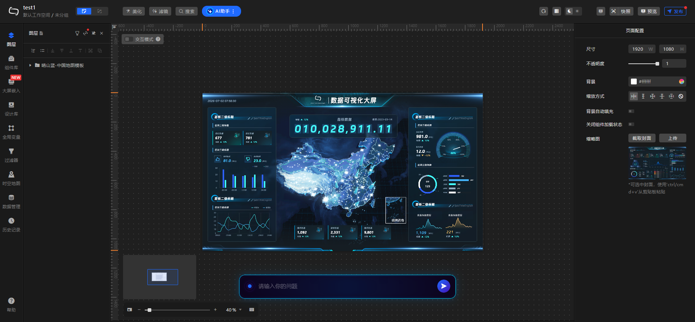

# kanban

DataV 风格的可视化看板平台：拖拽式大屏编辑器、模板库、组件库、发布/快照、访问控制与 AI 辅助生成。

DataV-style visual dashboard platform with a drag-and-drop editor, templates, publishing/snapshots, access control, and AI-assisted generation.



## 功能

- 可视化编辑器：画布拖拽、缩放、图层、组合、对齐、撤销/重做
- 组件库：G2 图表、地图、媒体、文本、装饰组件，支持自定义组件
- 模板与发布：模板库、看板发布、快照/回滚、访问密码/Token/IP 白名单
- 数据源：PostgreSQL / pgvector，组件数据绑定与全局变量
- AI 辅助：可视化技能包、LADV 智能生成（可选）
- 权限：JWT 登录、工作区成员与角色

## 技术栈

- 后端：JDK 25、summer-boot 4.2.0、PostgreSQL + pgvector、JWT
- 前端：React 19、TypeScript、Vite、Ant Design 6、AntV G2、Monaco Editor、Zustand
- 构建：Maven、npm

## 目录

```
kanban-backend/   后端（summer-boot）
kanban_web/       前端（React + Vite）
docs/             产品、开发、测试文档
scripts/          本地启停脚本
ScreenShot/       界面截图
```

## 快速开始

### 前置条件

- JDK 25（`JAVA_HOME` 指向 JDK 25）
- Maven 3.9+
- Node.js 20+
- PostgreSQL 17 + pgvector（本地或 Docker）
- summer 4.2.0（本项目依赖；如本地没有，请先在 summer 仓库执行 `mvn install -DskipTests`）

### 1. 数据库

创建数据库 `kanban`，并确保 pgvector 扩展可用。应用启动时会自动建表/种子数据，建表脚本见
`kanban-backend/src/main/resources/db/schema.sql`。

### 2. 本地密钥

```powershell
# 仓库根目录
mkdir build-test
# 按 docs/local-setup.md 创建 build-test/secrets.env
```

`build-test/` 已被 `.gitignore` 忽略，仅本地有效。

### 3. 启动

```powershell
# 后端 + 前端（Windows，自动读取 build-test/secrets.env）
powershell -ExecutionPolicy Bypass -File scripts\dev.ps1 -Action start

# 或手动
cd kanban-backend
mvn clean package -DskipTests
java -jar target\kanban-backend-boot.jar

cd ..\kanban_web
npm install
npm run dev
```

默认地址：前端 `http://localhost:5175`，后端 `http://localhost:8080`。
默认管理员 `admin / admin123`，**首次登录后请立即修改**。

## 配置

公开配置在 `kanban-backend/src/main/resources/application.yml`，敏感项使用环境变量占位：

| 环境变量 | 说明 |
| --- | --- |
| `SUMMER_DATASOURCE_URL` / `USERNAME` / `PASSWORD` | PostgreSQL 连接 |
| `KANBAN_JWT_SECRET` | JWT 签名密钥 |
| `KANBAN_BOOTSTRAP_ADMIN_USERNAME` / `PASSWORD` | 初始管理员 |
| `SUMMER_AI_API_KEY` | 可选，AI 兜底 Key |
| `KANBAN_LADV_API_KEY` | 可选，LADV 视觉模型 Key |
| `SUMMER_AI_EMBEDDING_ONNX_*` | 可选，本地 ONNX 向量化路径 |

详见 [docs/local-setup.md](docs/local-setup.md)。

## 文档

- [文档总览](docs/README.md)
- [需求文档](docs/需求文档/requirements.md)
- [开发文档](docs/开发文档/development.md)

## License

[Apache License 2.0](LICENSE)
