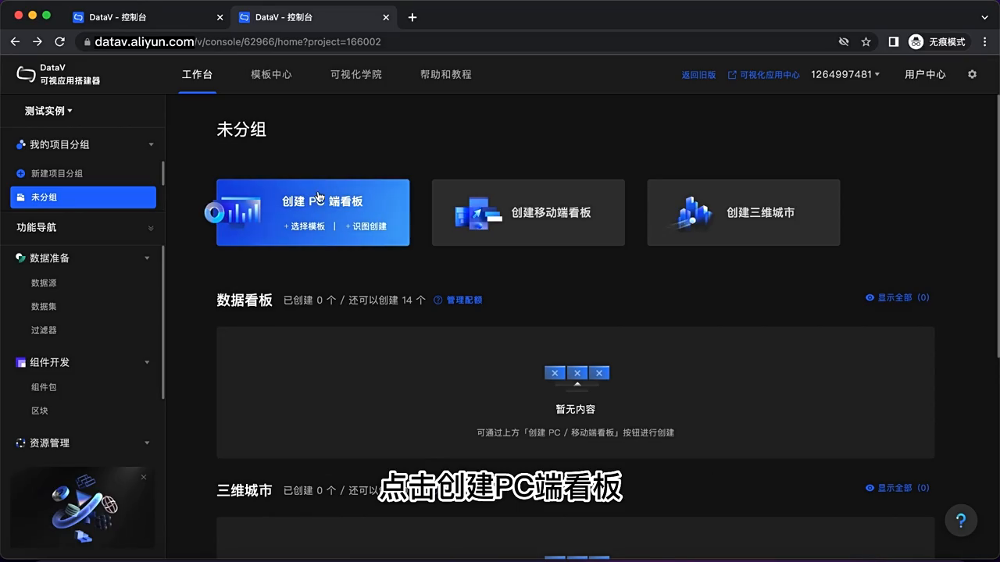
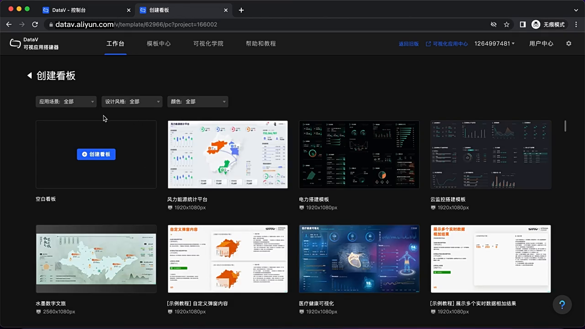
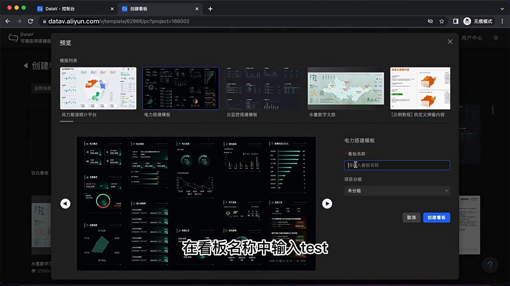
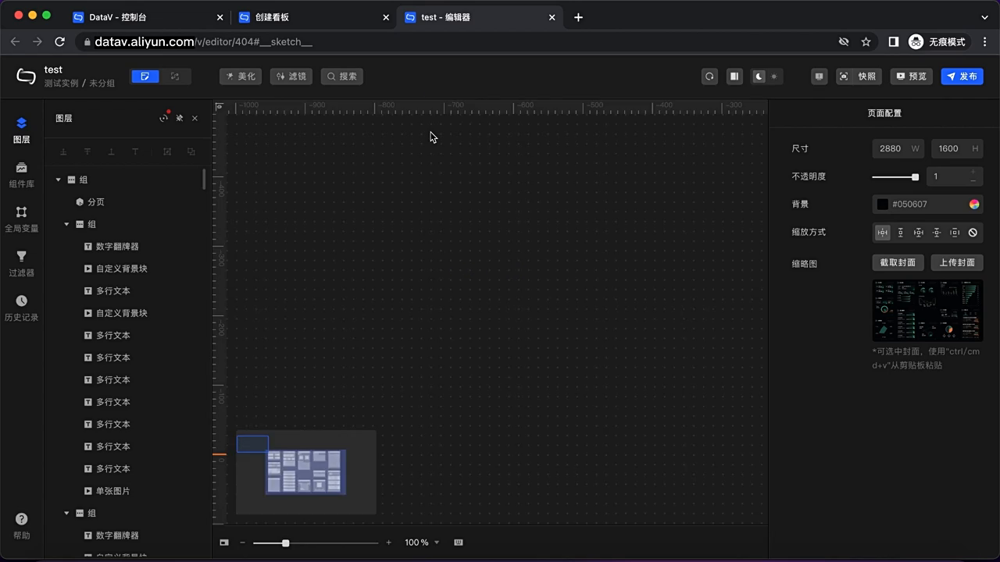
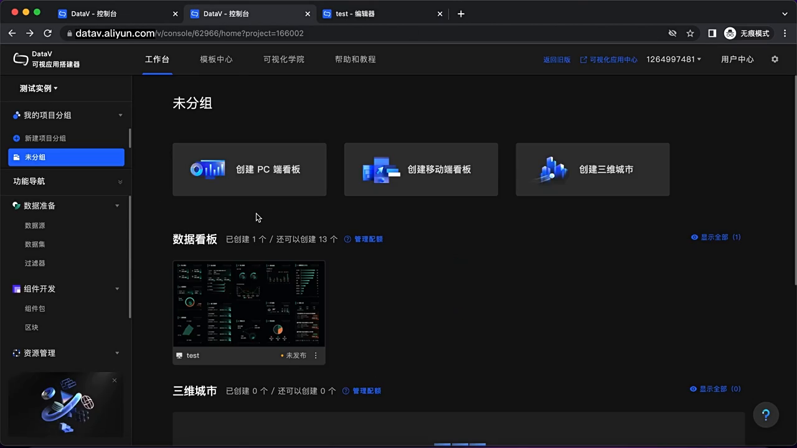
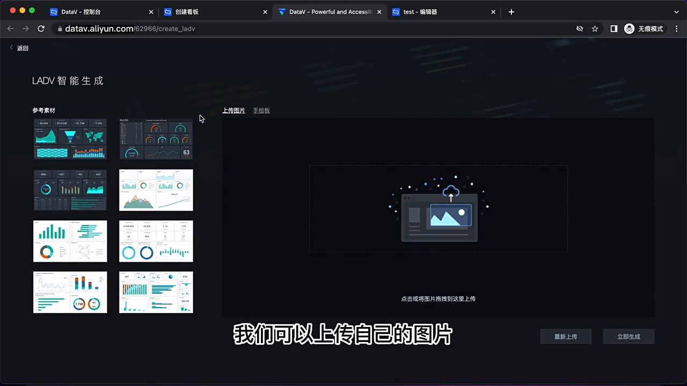
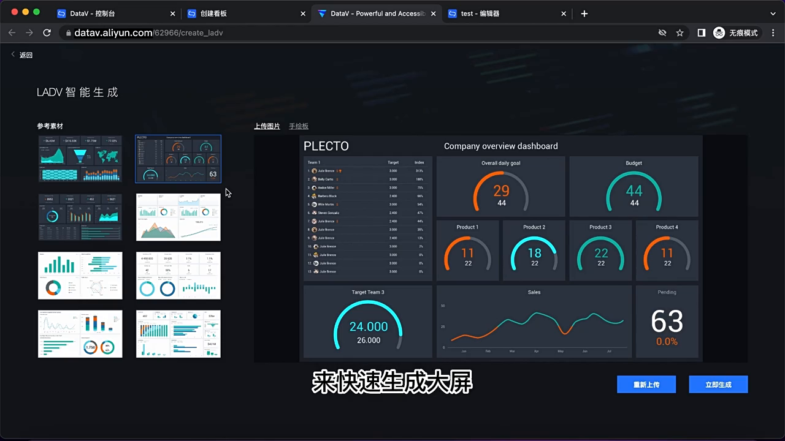
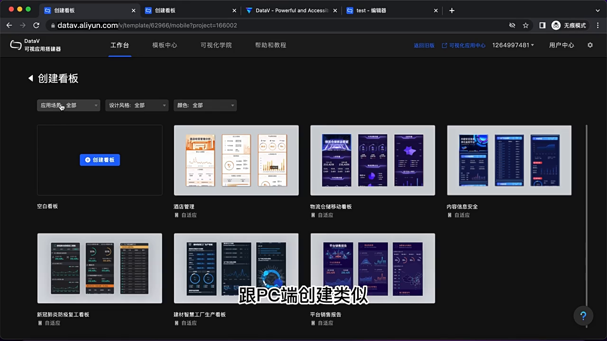
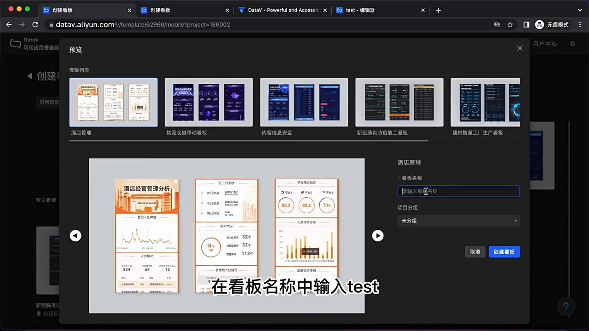
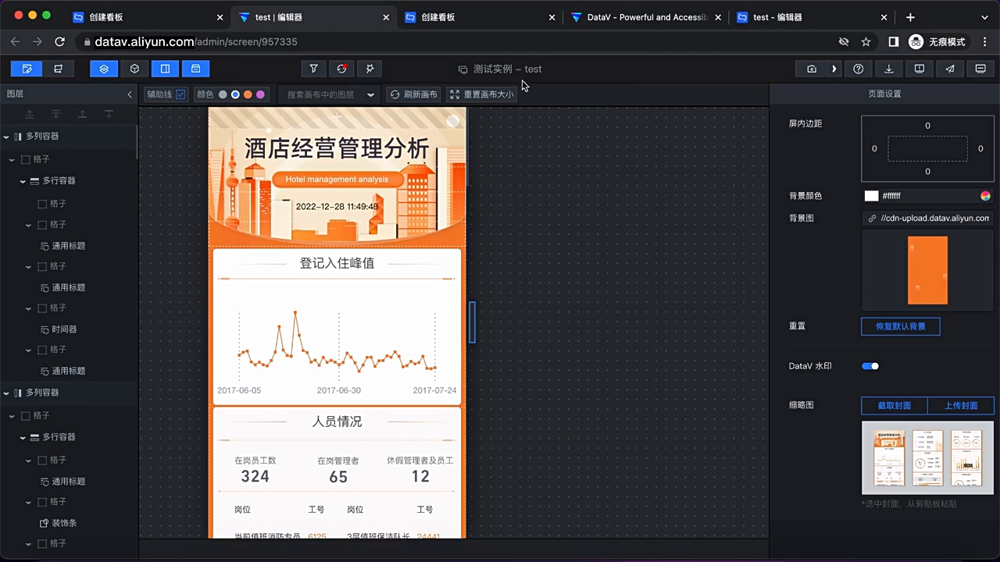

# DataV 智能数据可视化平台 - 看板创建使用文档

> 文档版本：v1.0
> 适用平台：DataV 控制台
> 文档类型：产品使用手册 / 项目交付文档

---

## 一、项目概述

### 1.1 项目简介

DataV 是阿里云推出的一款智能数据可视化平台（datav.aliyun.com），致力于帮助用户以零代码/低代码的方式快速搭建专业级数据可视化看板。平台支持 PC 端大屏、移动端看板、三维城市等多种展示形态，覆盖企业数据展示、运营监控、业务分析等典型场景。

### 1.2 核心能力

| 能力 | 描述 |
| --- | --- |
| 模板创建 | 内置大量行业模板，选择后即可快速生成看板 |
| 智能生成（LADV） | 上传图片或手绘稿，AI 自动识别并生成大屏 |
| 多端适配 | 支持 PC 端、移动端、三维城市等不同终端类型 |
| 可视化编辑 | 拖拽式画布，丰富的组件库，所见即所得 |
| 主题与样式 | 提供多套主题，支持自定义配色 |

### 1.3 适用人群

- 企业数据分析师
- 运营 / 产品经理
- 业务部门可视化需求方
- 政企 / 行业大屏搭建人员
- 前端 / 可视化开发者

---

## 二、平台入口与控制台

### 2.1 访问地址

```
https://datav.aliyun.com
```

### 2.2 控制台工作台

登录后默认进入「工作台」页面，主要区域包括：

- **左侧导航**：我的项目分组、新建项目分组、本分组、组件开发、组件管理、组件示例、配置与帮助、数据准备
- **顶部 Tabs**：工作台、模板中心、可视化学院、帮助和教程
- **右上角**：项目切换、可视化应用中心、用户中心
- **核心操作区**：
  - 创建 PC 端看板
  - 创建移动端看板
  - 创建三维城市
  - 数据看板列表（已创建的看板）
  - 三维城市列表

**图示：DataV 控制台工作台首页**



> 核心入口一目了然，PC 端看板、移动端看板、三维城市三个创建入口并列在「未分组」卡片区中。

### 2.3 看板类型总览

| 看板类型 | 适用场景 | 画布比例 | 创建入口 |
| --- | --- | --- | --- |
| PC 端看板 | 指挥中心、会议室大屏 | 1920×1080 等宽屏 | 工作台 → 创建 PC 端看板 |
| 移动端看板 | 手机 H5 页面 | 竖屏 375×667 等 | 工作台 → 创建移动端看板 |
| 三维城市 | 园区 / 楼宇 / 城市孪生 | 3D 场景 | 工作台 → 创建三维城市 |

---

## 三、创建 PC 端看板（模板方式）

### 3.1 流程概览

```
工作台 → 点击「创建 PC 端看板」→ 模板选择 → 条件筛选 → 预览 → 命名 → 创建 → 进入编辑器
```

### 3.2 详细步骤

#### Step 1：进入模板页面

在工作台「未分组」区域中，点击 **创建 PC 端看板** 大卡片，系统跳转到模板选择页面（`/console/.../pc/project-166002`）。

**图示：PC 端模板选择页（顶部三类筛选 + 模板卡片）**



> 顶部三大筛选维度：「应用场景」「设计风格」「颜色」，模板以卡片形式平铺展示，左上角是「空白看板」入口。

#### Step 2：筛选条件

页面顶部提供三类筛选下拉框：

- **应用场景**：全部 / 零售 / 电力 / 云计算 / 交通 / 医疗 / 组织 / 零售 / 农业 / 工业 / 通用 / 园区 / 制造 / 文旅 / 其他
- **设计风格**：全部 / 科技 / 数据可视化 / 信息图表 / 渐变 / 其他
- **颜色**：全部 / 暗色 / 蓝色 / 紫色 / 浅色

用户可按业务场景选择对应条件，模板列表实时刷新。

#### Step 3：选择模板

模板以卡片形式展示，鼠标悬停时卡片上会浮现两个操作按钮：

- **创建看板**：直接使用该模板创建
- **预览模板**：在弹窗中查看模板细节

预览弹窗中可左右切换查看同一系列的其他模板，并显示：
- 模板名称
- 模板所属名称
- 项目分组
- 「创建看板」/「取消」按钮

#### Step 4：创建看板

1. 在预览弹窗中填写 **看板名称**（例如：`test`）
2. 选择 **项目分组**（默认未分组）
3. 点击 **创建看板** 按钮
4. 系统跳转到编辑器（`datav.aliyun.com/editor/...`），加载完成后即可看到完整看板

**图示：模板预览弹窗 + 命名（视频示例："电力搭建模板" + 看板名 "test"）**



> 弹窗左侧为模板缩略图列表，中间是大图预览，右侧是命名 + 项目分组表单。视频示例中输入的看板名为 `test`，选择"未分组"作为所属项目分组。

### 3.3 进入编辑器

创建成功后系统自动进入 PC 端看板编辑器，编辑器包含：

- **顶部工具栏**：美化、滤镜、搜索、保存、预览、发布
- **左侧**：图层、组件库、全局变量、过滤器、历史记录
- **中部**：画布（默认 2880 × 1600，支持缩放与标尺）
- **右侧**：页面配置（尺寸、不透明度、背景、缩放方式、缩略图）
- **底部**：缩放控制（默认 100%）

**图示：PC 端看板编辑器**



> 左侧组件库已加载电力搭建模板的所有组件（数字翻牌器、自定义背景块、多行文本等），画布区呈现完整的可视化版面。

### 3.4 创建成功后回到工作台

**图示：创建 "test" 看板后，工作台列表新增 1 条记录**



> 数据看板区域从"已创建 0 个"变为"已创建 1 个"，缩略图就是刚刚创建的看板，可继续点击编辑、预览或发布。

---

## 四、智能生成大屏（LADV 智绘）

### 4.1 功能简介

LADV（Large-scale Automated Dashboard Visualizer）是 DataV 提供的 AI 智能生成大屏能力。用户只需上传一张**参考图**（如截图、UI 设计稿、竞品大屏、甚至是手绘草图），系统即可识别图中的元素布局与数据维度，自动生成可编辑的 DataV 看板。

### 4.2 入口

在工作台中：
- 鼠标移动到 **创建 PC 端看板** 卡片上
- 在出现的两个按钮中，点击 **「识图创建」**
- 系统打开新页面：`datav.aliyun.com/.../create_ladv`

### 4.3 界面分区

| 区域 | 位置 | 作用 |
| --- | --- | --- |
| 标题栏 | 左上 | LADV 智能生成 |
| 参考素材 | 左侧 | 系统预设的参考大屏缩略图 |
| 上传图片 / 手绘稿 | 右侧 Tab | 上传自定义素材 |
| 预览画布 | 右侧主区域 | 显示识别生成的大屏 |
| 重新上传 / 立即生成 | 右下角 | 重新选图或确认生成 |

**图示：LADV 智能生成初始页**



> 左侧展示系统预置的 8 张参考大屏缩略图，右侧是占位提示"点击或将图片拖拽到这里上传"。底部两个按钮"重新上传"和"立即生成"在未上传时为禁用态。

### 4.4 使用流程

1. **选择素材**：
   - 在左侧「参考素材」中挑选系统提供的样例
   - 或切换到「上传图片 / 手绘稿」Tab 上传本地图片
2. **预览效果**：
   - 选中素材后，右侧画布展示基于该图生成的大屏效果
   - 视频示例：上传一张「PLECTO Company overview dashboard」样图，系统生成包含团队目标、预算、产品销量、销售额、临时工时、销售额折线、待办百分比等模块的完整大屏
3. **生成看板**：
   - 点击右下角「立即生成」按钮
   - 系统在编辑器中打开新生成的看板，用户可进一步微调

**图示：LADV 选中参考素材后，右侧自动生成大屏预览**



> 视频示例中，参考素材被选中后高亮（蓝色边框），右侧实时渲染出对应的可视化大屏。"立即生成"按钮由灰转蓝可点击。

### 4.5 适用场景

- 快速复刻某张参考图的版式
- 将纸质 / 手绘草图快速数字化
- 没有现成模板时，5 分钟产出可交付大屏

---

## 五、创建移动端看板

### 5.1 流程概览

```
工作台 → 点击「创建移动端看板」→ 模板选择 → 筛选 / 预览 → 命名 → 创建 → 进入移动编辑器
```

### 5.2 详细步骤

#### Step 1：进入移动端模板页

点击工作台中的 **创建移动端看板** 卡片，跳转到移动端模板选择页面（URL 携带 `mobile/project-166002`）。

**图示：移动端模板选择页（竖屏 375 模板）**



> 移动端模板以手机壳形式展示（竖屏 375×667），与 PC 端保持同样的三类筛选 + 模板卡片布局。

#### Step 2：筛选与预览

操作逻辑与 PC 端保持一致：
- 顶部三类筛选（应用场景 / 设计风格 / 颜色）
- 模板以手机壳形式展示（竖屏 375×667）
- 悬停出现「创建看板」/「预览模板」按钮

视频中看到的移动端模板示例：
- 酒店管理
- 物流仓储移动看板
- 内容信息安全
- 新冠肺炎防疫复工看板
- 建材智慧工厂生产看板
- 平台销售报告

#### Step 3：预览与创建

1. 点击 **预览模板**，弹出大图预览（视频示例为「酒店管理」）
2. 在右侧表单中输入看板名称（示例：`test`）
3. 点击 **创建看板**
4. 系统跳转到移动端编辑器（`/dm/screen/...`）

**图示：移动端模板预览弹窗 + 命名（视频示例：酒店管理）**



> 弹窗里左侧是同系列移动模板切换，中间是当前模板的手机大图，右侧填写看板名称（视频中输入 "test"）+ 项目分组。

### 5.3 移动端编辑器特性

**图示：移动端看板编辑器**



> 视频示例中加载的是「酒店经营管理分析」看板（橙色主题）。左侧是图层树（多列容器 / 格子 / 多行容器 / 通用标题 / 装饰条 / 表格等），中部是竖屏画布，右侧是页面设置（屏内边距、背景颜色、背景图、缩略图、DataV 水印开关）。

主要特性：
- 顶部菜单：撤销 / 重做 / 预览 / 缩放等
- 左侧：组件 / 图层 / 资源树
- 中部：竖屏画布（自适应尺寸）
- 右侧：页面配置（背景颜色、背景图、缩略图、Datav 水印等）
- 画布上辅助线 / 颜色标注 / 画布大小 / 刷新率 / 重置画布大小等编辑工具
- 默认显示 `加载中...` 占位组件

---

## 六、看板编辑器功能速查

### 6.1 编辑器主界面（PC 端）

| 区域 | 功能 |
| --- | --- |
| 顶部工具栏 | 美化、滤镜、搜索、缩放、组件 ID、画布尺寸 |
| 左侧组件库 | 图表类（柱状图、折线图、饼图、地图等）、文本类、媒体类、控件类 |
| 中部画布 | 所见即所得编辑区域，可拖拽、缩放、对齐 |
| 右侧属性面板 | 页面配置、组件位置、尺寸、坐标、层级 |
| 底部状态栏 | 缩放比例、组件层级操作 |

### 6.2 常用操作

- **添加组件**：从左侧组件库拖入画布
- **修改属性**：选中组件后在右侧面板调整
- **数据接入**：在组件上配置数据源（API、数据库、CSV、静态数据）
- **调整层级**：右键 → 置顶 / 置底 / 上移 / 下移
- **预览**：顶部「预览」按钮查看发布效果

### 6.3 移动端编辑器

- 竖屏画布
- 适配手指操作的组件尺寸
- 顶部工具栏：撤销/重做、辅助标尺、开启/关闭对齐线、放置填充大小

---

## 七、看板管理与发布

### 7.1 看板列表

工作台 → 数据看板区，显示已创建的看板：
- 缩略图
- 看板名称
- 所属分组
- 创建时间 / 发布状态

支持的操作：查看全部、删除、复制、编辑、预览、发布。

### 7.2 发布流程

1. 在编辑器中完成看板配置
2. 点击「保存」保存修改
3. 点击「发布」获取访问链接
4. 将链接嵌入到大屏设备、网页或 App 中

---

## 八、最佳实践

### 8.1 模板选型建议

| 场景 | 推荐筛选条件 |
| --- | --- |
| 指挥中心大屏 | 应用场景：通用 / 工业；设计风格：科技；颜色：暗色 / 蓝色 |
| 业务运营看板 | 应用场景：零售 / 通用；设计风格：数据可视化；颜色：浅色 / 蓝色 |
| 行业专题（医疗/交通/能源） | 优先使用对应行业模板 |

### 8.2 智能生成使用技巧

- 提供**清晰、构图明确**的参考图效果更好
- 手绘稿建议用**黑色马克笔 + A4 白纸**拍摄
- 单次只参考一张图，多图场景可多次生成再合并

### 8.3 性能与体验

- 单个看板组件数量建议控制在 30 个以内
- 数据接口做缓存，避免频繁刷新
- 暗色主题在大屏设备上视觉冲击更强

---

## 九、常见问题（FAQ）

**Q1：创建看板后找不到入口？**
A：创建成功后会跳转到编辑器；返回工作台后，已创建的看板会出现在「数据看板」列表中。

**Q2：智能生成的效果不理想？**
A：参考图的清晰度和构图影响识别效果，建议更换更清晰、对比度更高的图片再次尝试。

**Q3：模板筛选没有结果？**
A：尝试放宽筛选条件，例如把「应用场景」改为「全部」。

**Q4：移动端和 PC 端能互转吗？**
A：目前两者画布尺寸与组件库不同，不支持直接互转，需要分别创建。

**Q5：编辑器加载卡顿？**
A：检查网络；如单个看板组件过多，建议拆分或精简。

---

## 十、附录

### 10.1 视频中出现的关键页面

| 序号 | 页面 | URL 路径 | 文档截图 |
| --- | --- | --- | --- |
| 1 | DataV 工作台 | `/console/.../home?project=166002` | screenshots/01-workbench.png |
| 2 | PC 端模板选择 | `/console/.../pc/project-166002` | screenshots/02-pc-templates.png |
| 3 | 模板预览 + 命名 | `/console/.../pc/project-166002`（弹窗） | screenshots/03-pc-preview.png |
| 4 | PC 端编辑器 | `/editor/40d4` | screenshots/04-pc-editor.png |
| 5 | 创建成功后工作台 | `/console/.../home?project=166002` | screenshots/05-workbench-with-dashboard.png |
| 6 | LADV 智能生成 | `/console/.../create_ladv` | screenshots/06-ladv-upload.png |
| 7 | LADV 生成预览 | `/console/.../create_ladv` | screenshots/07-ladv-preview.png |
| 8 | 移动端模板选择 | `/console/.../mobile/project-166002` | screenshots/08-mobile-templates.png |
| 9 | 移动端预览 + 命名 | `/console/.../mobile/project-166002`（弹窗） | screenshots/09-mobile-preview.png |
| 10 | 移动端编辑器 | `/dm/screen/957335` | screenshots/10-mobile-editor.png |

### 10.2 关键术语

| 术语 | 含义 |
| --- | --- |
| 看板（Dashboard） | 一个完整的数据可视化页面 |
| 组件（Widget） | 看板中的单个可视化元素 |
| 模板（Template） | 预置的看板样式 |
| LADV | DataV 智能生成大屏能力 |
| 项目分组 | 看板的分类管理单元 |
| 数据源 | 看板组件所使用的数据来源 |

### 10.3 相关资源

- 官方控制台：https://datav.aliyun.com
- 帮助与教程：控制台「帮助和教程」Tab
- 可视化学院：控制台「可视化学院」Tab
- 模板中心：控制台「模板中心」Tab

---

*文档结束*
