# DataV 看板发布教程

> 本教程基于阿里云 DataV 可视化应用搭建器，介绍如何将搭建好的看板发布成可分享的链接，并配置访问限制、分享信息与加载样式。  
> 视频时长约 2 分钟，已按操作流程拆解为关键步骤截图。

## 一、发布流程总览

DataV 提供两种发布入口，发布效果一致：

| 入口 | 路径 | 适用场景 |
| --- | --- | --- |
| **控制台发布** | 工作台 → 鼠标移入看板卡片 → 点击右上角"发布"图标 | 看板已搭建完成、只需快速发布 |
| **编辑器发布** | 打开看板编辑器 → 右上角"发布"按钮 | 还在编辑中、想边改边发 |

发布后系统会自动生成一条**分享链接**（形如 `https://pre.datav.aliyun.com/share/page/...`），可复制后直接在浏览器中打开。

---

## 二、控制台发布流程

### 步骤 1：进入工作台

打开 DataV 控制台（`datav.aliyun.com/v/console`），在工作台"数据看板"列表中可以看到所有看板。已发布的看板右下角会显示绿色"**已发布**"角标，未发布的显示黄色"**未发布**"。

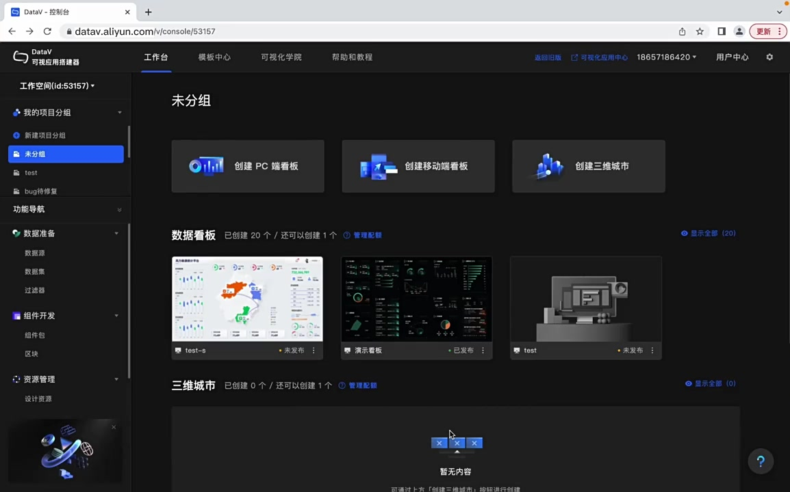

### 步骤 2：鼠标移入看板卡片

将鼠标移到想要发布的看板上，看板右上角会出现三个快捷图标：**预览**、**发布**、**编辑**。

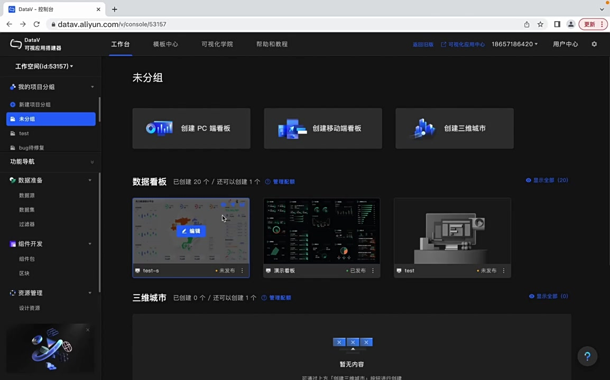

### 步骤 3：点击"发布"图标

点击右上角**中间**的发布图标（分享/上传图标），会弹出"发布"确认弹窗。

> 💡 中间是发布，最右是编辑，最左是预览。

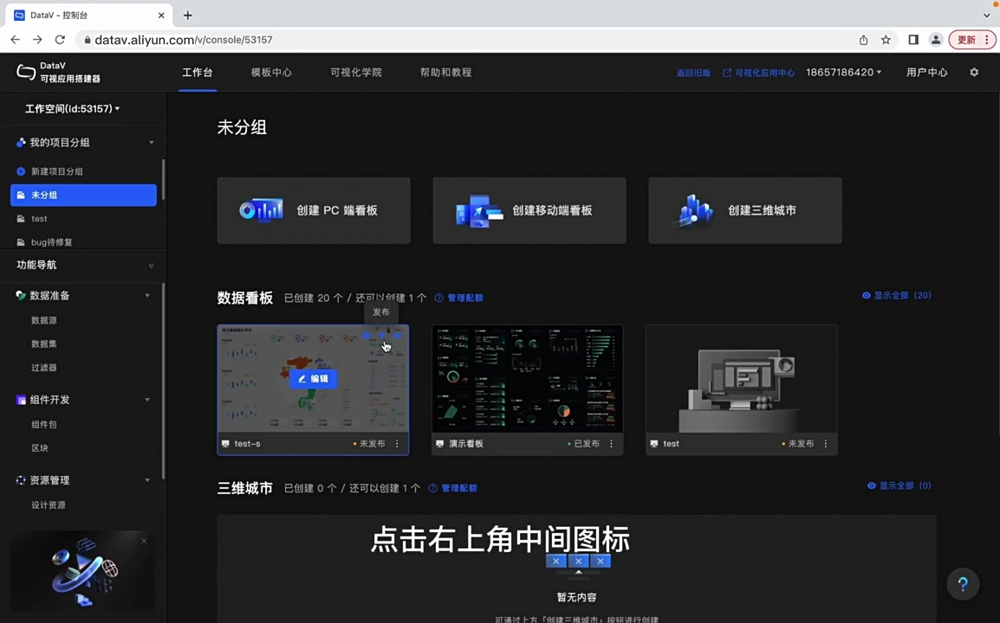

### 步骤 4：确认发布

弹窗中会显示当前状态（"未发布"或"已发布"），点击"**发布大屏**"按钮即可开始发布。

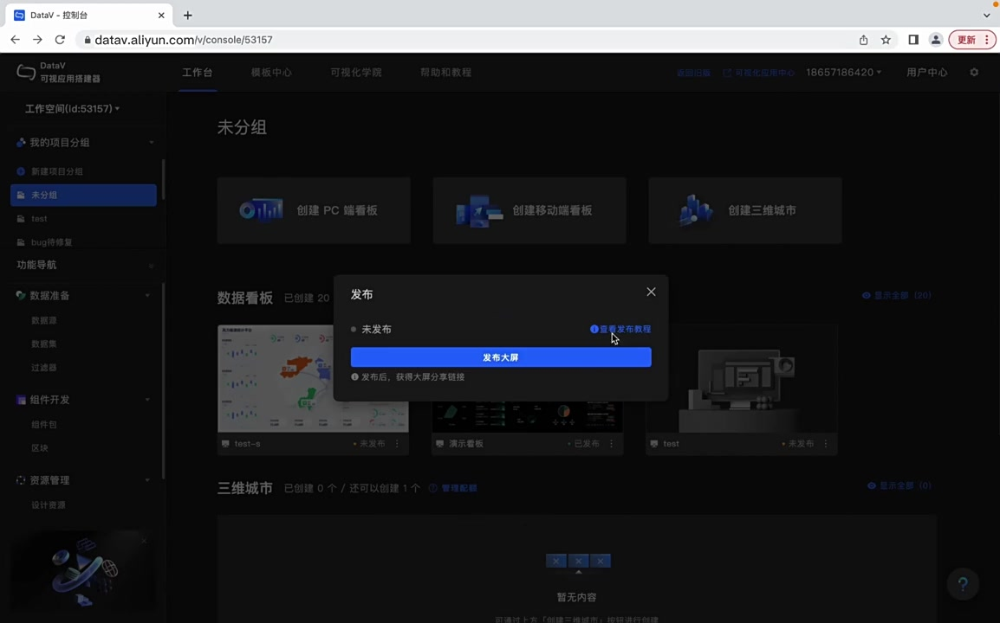

### 步骤 5：发布成功，复制链接

发布完成后，弹窗顶部会显示绿色提示"**发布成功，链接已复制到剪贴板！**"，并自动填充分享链接，点击"**复制**"按钮或右上角链接图标可重新复制。

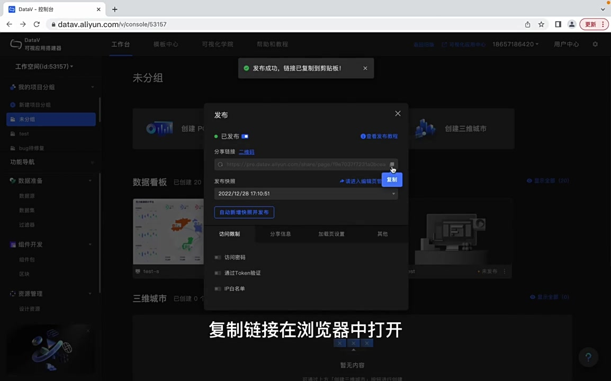

### 步骤 6：查看看板

将链接粘贴到浏览器中打开，即可看到发布后的看板内容。

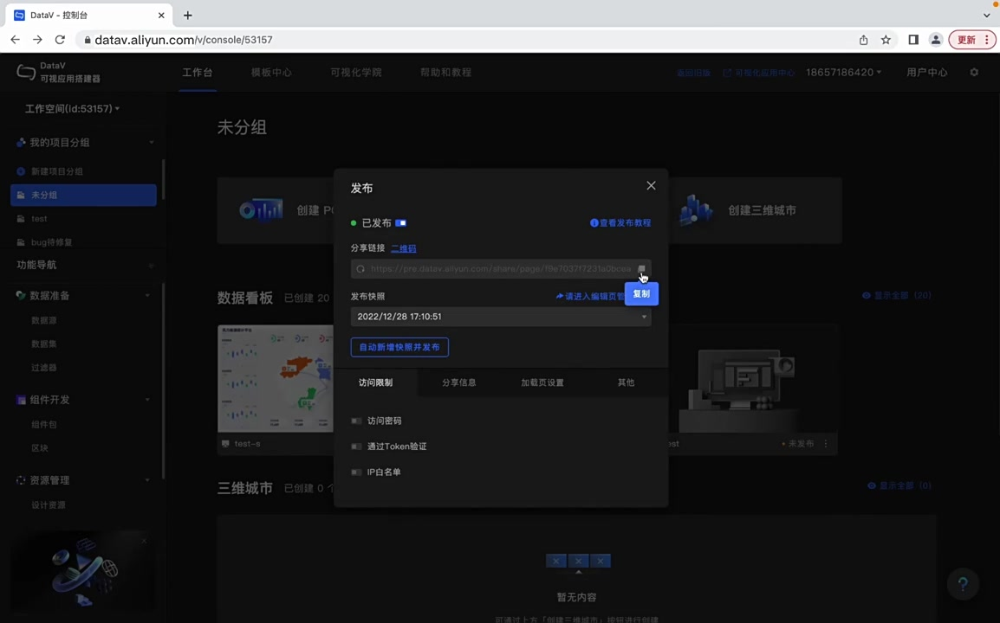

---

## 三、编辑器发布流程

如果想在编辑看板的同时直接发布，可以在看板编辑器内完成。

### 步骤 1：进入编辑器

在工作台点击"**编辑**"图标，或在已打开的编辑器页面右上角找到"**发布**"按钮（与"快照""预览"并排）。

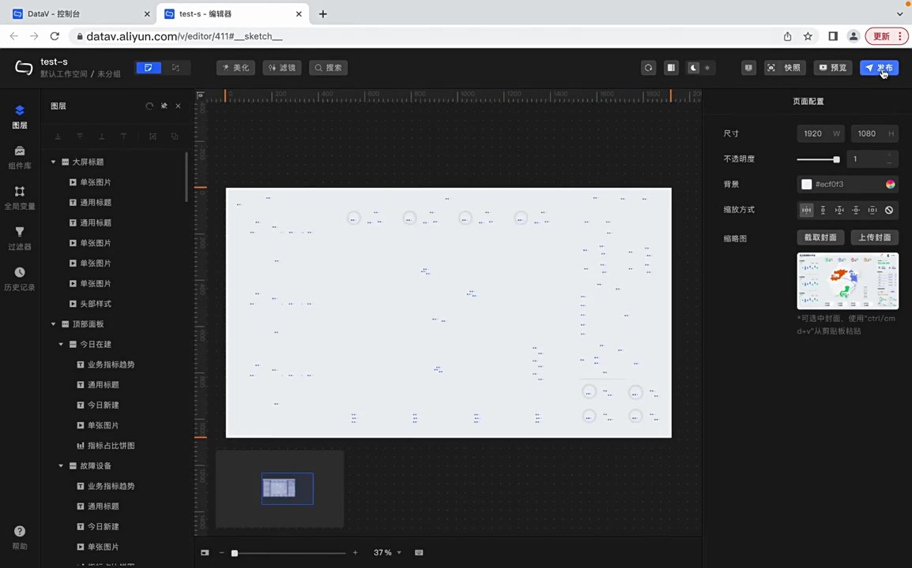

### 步骤 2：点击"发布"按钮

点击右上角的"**发布**"按钮，弹出"发布"配置弹窗（首次发布会先 loading 加载）。

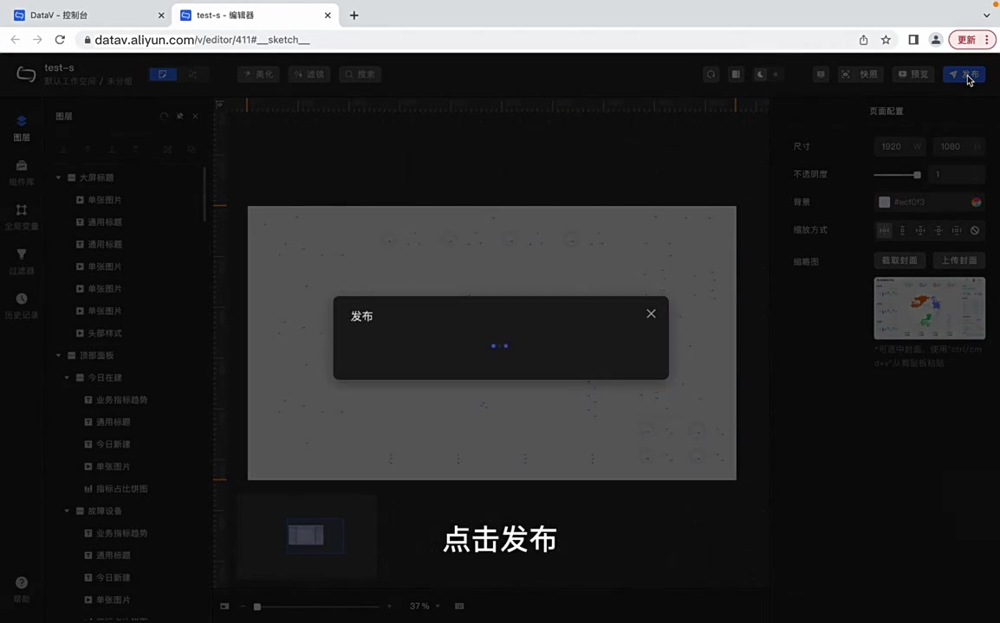

### 步骤 3：配置发布快照

发布弹窗默认显示"**已发布**"状态和"**分享链接**"。下方有"**发布快照**"下拉框，可选择要发布到哪个历史快照版本，也可勾选"**自动新增快照并发布**"让系统自动生成新快照。

> 📌 **快照说明**：每次发布会在编辑器中保存一个快照，可随时回滚到任意历史版本。

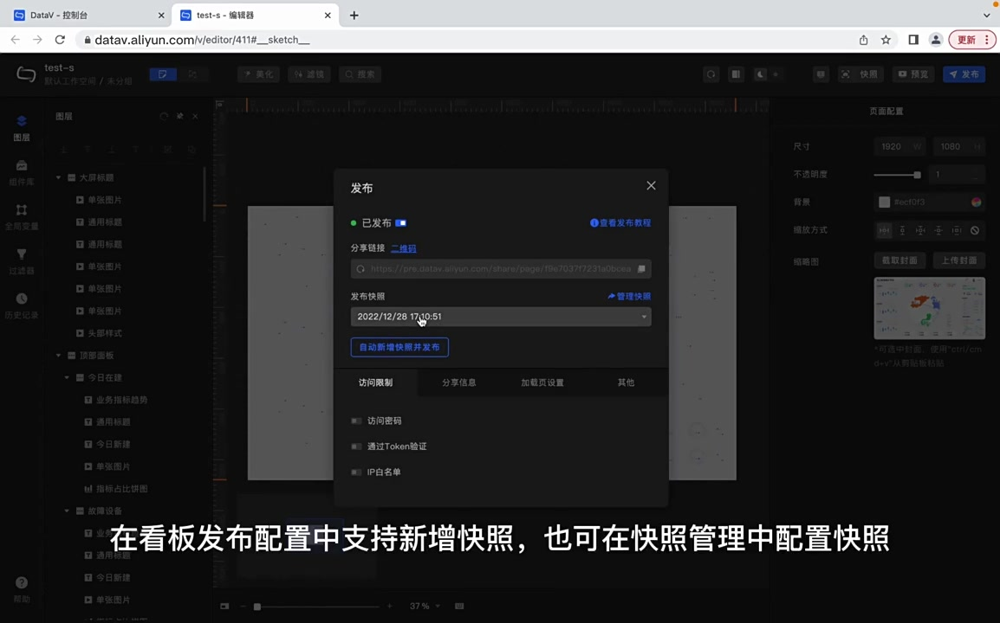

### 步骤 4：管理快照（回滚）

点击"**管理快照**"链接，可打开快照管理面板。在快照列表中点击对应快照的"**回滚**"按钮，系统会弹窗提示"回滚后当前内容将无法追溯，如需留存请先保存为快照"，确认后即可回滚到该历史版本。

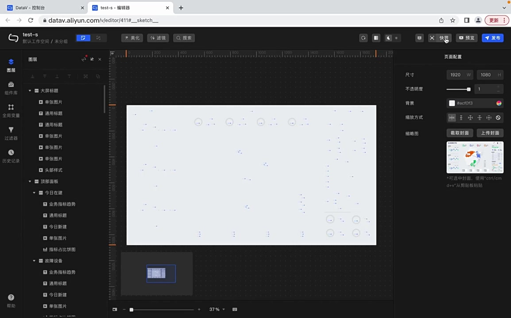

回滚成功的效果：

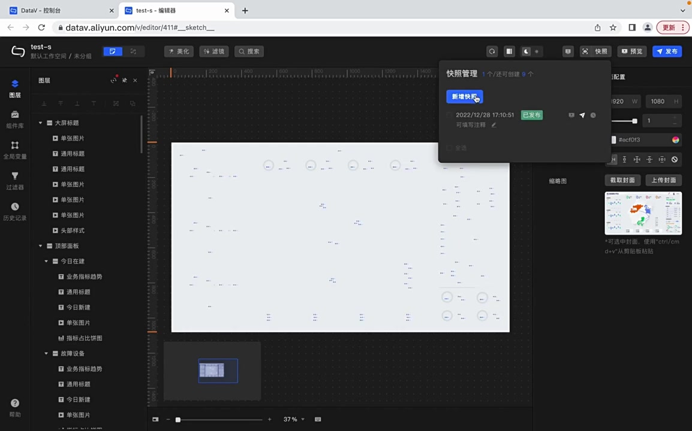

### 步骤 5：编辑器中直接发布

回到编辑器，在右上角点击"**发布**"按钮，会再次弹出发布配置弹窗。

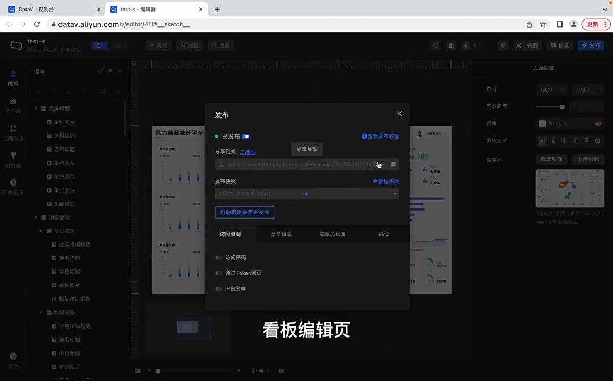

### 步骤 6：完成发布

发布完成后弹窗顶部会出现"**更新成功**"绿色提示，链接、二维码均会同步更新。

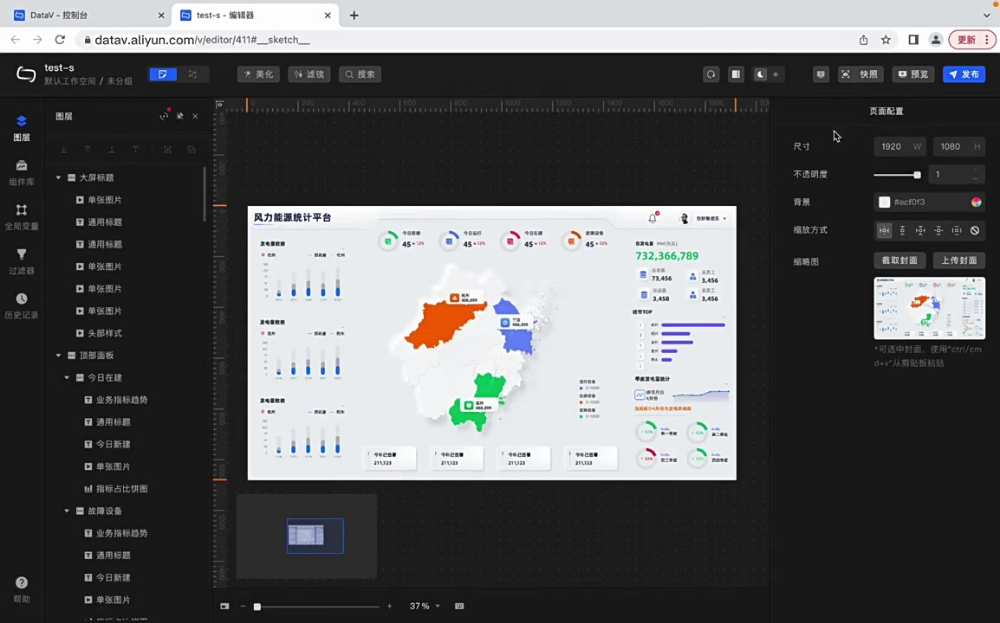

---

## 四、访问限制（3 种方式）

发布弹窗下方有"**访问限制**"标签页，支持 3 种访问控制方式，**可叠加使用**：

### 1. 访问密码

勾选"**访问密码**"后输入密码，访客打开链接必须输入正确密码才能查看。

**密码规则**（需同时满足以下 4 条）：
- 长度 ≥ 6 位
- 至少包含 1 个大写字母 `A-Z`
- 至少包含 1 个小写字母 `a-z`
- 至少包含 1 个数字 `0-9`

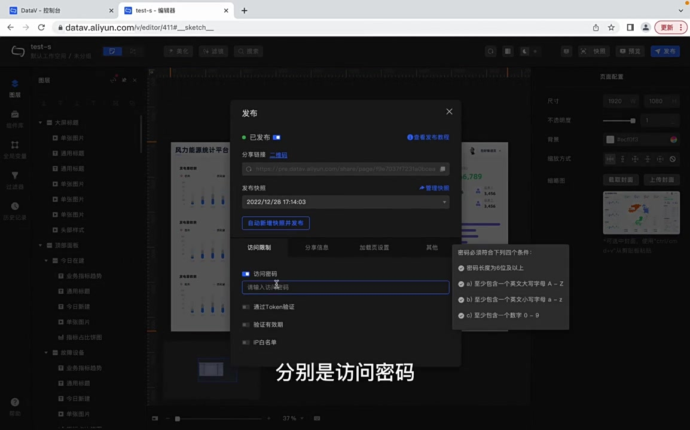

### 2. 通过 Token 验证

勾选"**通过 Token 验证**"后，系统会自动生成一串 Token（默认约 40 位字符），也可使用自定义 Token。访客打开链接时必须携带 `?token=xxx` 参数才能通过验证。

**额外可选项**：
- **签名地址只允许打开一次**：开启后，带 Token 的链接仅可访问一次，第二次访问会被拒绝。
- **验证有效期**：可设置 Token 的过期时间。

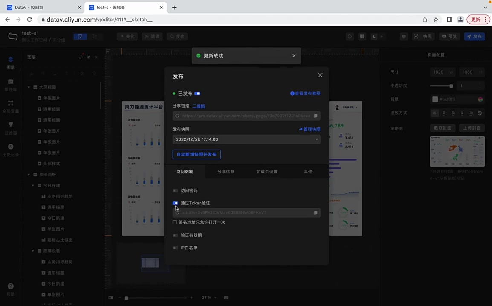

### 3. IP 白名单

勾选"**IP 白名单**"后，输入允许访问的 IP 地址，多个 IP 用英文逗号 `,` 分隔。开启后**仅允许白名单中的 IP 访问**。

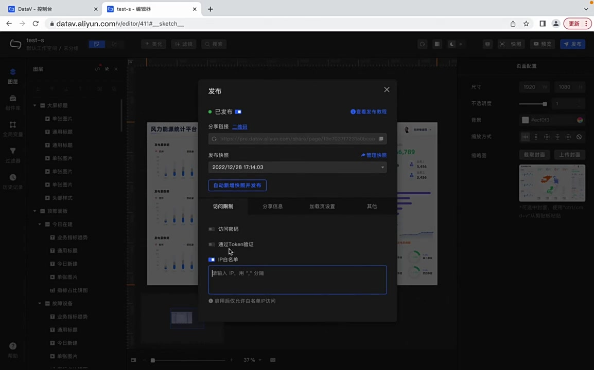

---

## 五、自定义分享信息

切换到"**分享信息**"标签页，可配置看板的分享卡片样式：

- **标题**：默认显示"项目名"，可自定义（会显示在分享链接的网页标题/卡片标题处）。
- **描述**：自定义看板简介。
- **图片**：上传分享卡片的封面图（支持输入图片地址或拖入/点击上传本地图片，点击预览图可将线上图片替换到输入框）。

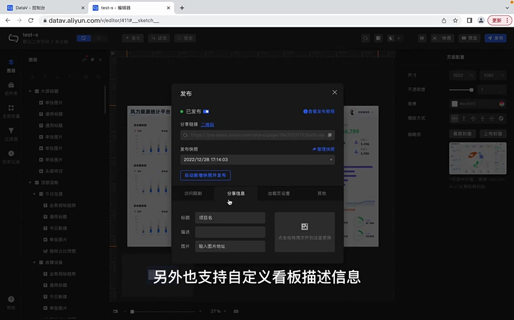

---

## 六、自定义加载页设置

切换到"**加载页设置**"标签页，可配置看板加载时的等待页面：

- **背景**：可使用颜色选择器设置加载页背景色（默认 `#0f2a42`）。
- **Logo**：可输入图片地址设置加载页中央显示的 Logo。

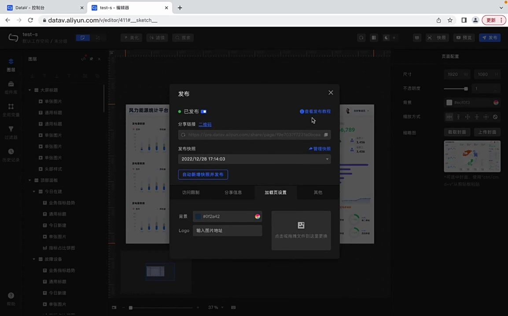

---

## 七、操作小贴士

1. **快照是救命稻草**：每次大改之前先手动"新增快照"，出问题了能秒回滚。
2. **访问限制建议叠加**：生产环境推荐"访问密码 + IP 白名单"双保险。
3. **签名链接一次性**：调试 Token 验证时建议勾上"只允许打开一次"，防止链接被乱传。
4. **分享卡片要好看**：自定义分享信息里的标题/描述/图片，会在链接被分享到 IM 时作为预览卡片展示。
5. **链接要定期轮换**：如果用了 Token 验证，定期重置 Token 能避免历史链接被滥用。

---

## 八、相关入口

- **DataV 控制台**：`https://datav.aliyun.com/v/console`
- **编辑器**：控制台 → 看板卡片 → 编辑
- **快照管理**：编辑器 → 右上角"快照" → 管理快照
- **帮助文档**：控制台顶部"**帮助和教程**"标签
